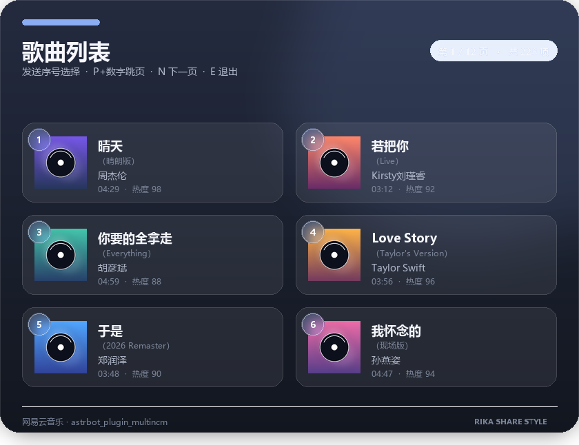
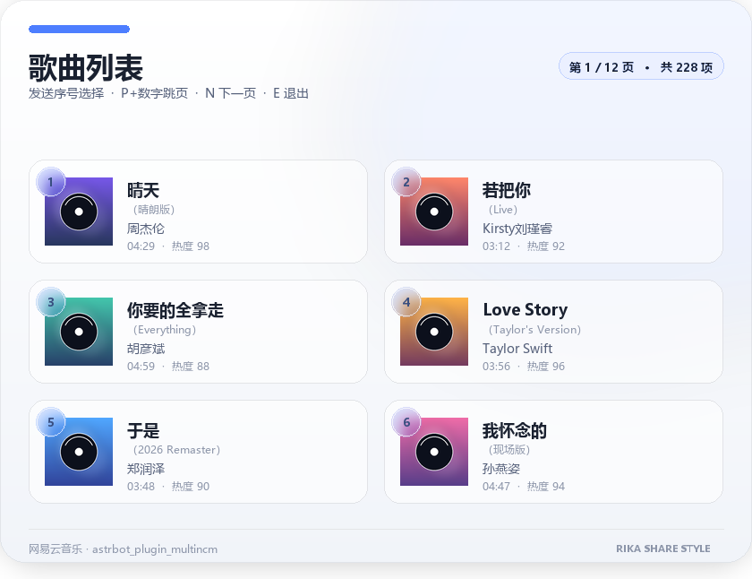
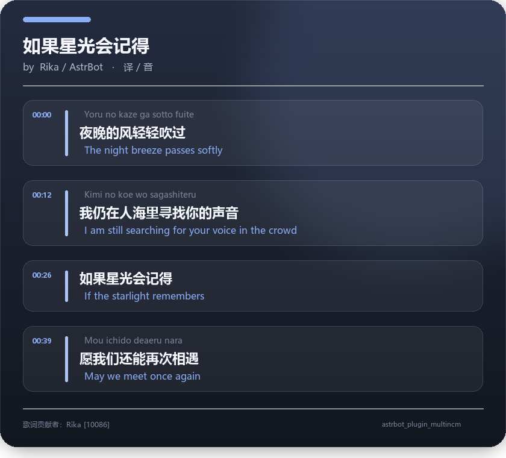
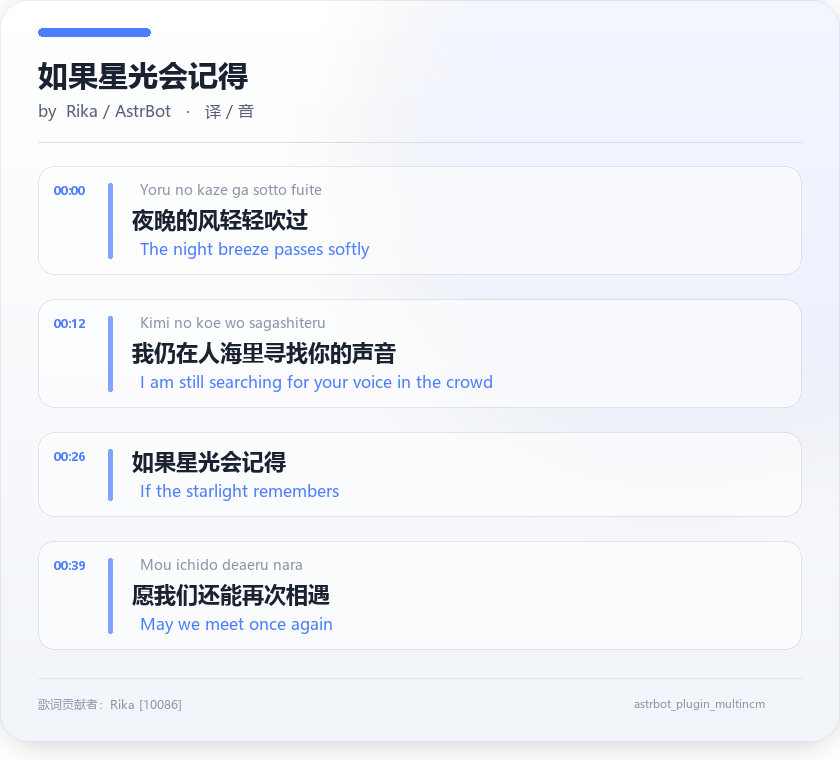

# astrbot_plugin_multincm

AstrBot 网易云多选点歌插件，移植自 [nonebot-plugin-multincm](https://github.com/lgc-NB2Dev/nonebot-plugin-multincm)。

## ✨ 功能特性

- 🎵 **多类型搜索**：支持搜索歌曲、专辑、歌单、电台节目、电台
- 📄 **翻页选择**：搜索结果支持翻页、跳页、退出
- 🎨 **双主题渲染**：使用 Pillow 绘制亮色/暗色搜索列表与歌词图片
- 🔗 **链接解析**：`解析 [链接]` 指令支持网易云标准链接和 163cn.tv 短链接；安装莉卡解析后链接自动解析由其接管（见下方「与莉卡解析联动」）
- 🎤 **音频发送**：自动下载音频并发送语音/文件
- 📝 **歌词获取**：获取歌词并以图片形式发送
- 🔐 **多种登录**：支持 Cookie、手机号、邮箱、游客登录

## 📦 安装

1. 将插件文件夹放入 AstrBot 的 `data/plugins/` 目录
2. 在插件目录安装依赖：`pip install -r requirements.txt`（AstrBot 通常会自动安装）
3. 重启 AstrBot

> **零 API 依赖 / 全异步**：上游 pyncm 已从 PyPI / GitHub 下架。本插件不再依赖任何第三方网易云 SDK，所需能力（加解密、会话、请求、端点）已融合为项目自带的 `netease/` 客户端层。网络请求基于 `httpx.AsyncClient` 原生 `async/await`，不使用 `requests`、不占用线程池；插件初始化与销毁走 AstrBot 的 `initialize()` / `terminate()` 异步生命周期钩子。无需 `pip install pyncm`。

## 🎯 使用方法

### 搜索指令

| 指令 | 功能 |
|------|------|
| 点歌 [歌名/ID] | 搜索歌曲 |
| 专辑 [名/ID] | 搜索专辑 |
| 歌单 [名/ID] | 搜索歌单 |
| 声音 [名/ID] | 搜索电台节目 |
| 电台 [名/ID] | 搜索电台 |

### 操作指令

| 指令 | 说明 |
|------|------|
| 数字 | 选择对应序号 |
| 上一页 / P | 翻到上一页 |
| 下一页 / N | 翻到下一页 |
| P+数字 | 跳到指定页 |
| 退出 / E | 退出选择模式 |

### 其他指令

| 指令 | 功能 |
|------|------|
| 解析 [链接] | 解析网易云链接 |
| 歌词 [链接] | 获取歌词图片 |
| 直链 [链接] | 获取播放直链 |
| 点歌帮助 | 显示帮助 |

> **注意**：指令与参数之间必须用空格隔开（例如 `点歌 Lemon`）。
> 像日常聊天中的「点歌的人真多」这类没有空格的消息不会被识别为指令，避免误触发。

### 与莉卡解析联动

本插件**不再自动解析**聊天中出现的网易云链接。当已安装
[astrbot_plugin_rika_share](https://github.com/iris1598/astrbot_plugin_rika_share)（莉卡解析）时，
它会在启动时把本插件接入为一个「网易云音乐」解析器：用户发送网易云链接后由莉卡渲染分享卡片
并单独发送音频，登录态（Cookie / 账号）复用本插件的配置；本插件未安装时莉卡侧没有这个解析器。

- 联动不影响本插件的任何指令（点歌 / 解析 / 歌词 / 直链等照常可用）；
- 「解析 / 歌词 / 直链」等指令消息（参数里带链接时）由本插件响应，莉卡侧自动让出，不会重复回复；
- **发送形态跟随本插件的设置**：分享卡片渲染成功后不再重复发送「莉卡解析 | …」文本；
  开启 `use_music_card` 时 QQ 平台**在解析卡片之后**再发送**音乐卡片**（替代文本与语音，由协议端内置签名服务处理）；
  开启 `send_as_file` 时音频以文件而非语音发送；
- 在莉卡的网页设置页「解析器开关」里可以单独关掉「网易云音乐」解析器；
- 本插件被停用时联动解析一并停用；
- VIP 歌曲在未登录（游客）状态下拿不到音频地址，此时仅发送卡片并在卡片上附带提示
  （音乐卡片也不会发送）。改动发送相关开关后，新解析的链接立即生效；
  已缓存的内容需要莉卡的 `/clear_cache` 清理后才会刷新。

## ⚙️ 配置项

图片渲染支持 `render_theme` 配置：

- `dark`：深海军蓝渐变、品牌色柔光与暗色玻璃卡片（默认）
- `light`：近白渐变、轻柔品牌色光晕与亮色玻璃卡片

搜索列表与歌词图片会统一使用所选主题。

| 配置项 | 类型 | 默认值 | 说明 |
|--------|------|--------|------|
| cookie_music_u | string | "" | 网易云 Cookie MUSIC_U 值 |
| phone | string | "" | 手机号（用于登录） |
| email | string | "" | 邮箱（用于登录） |
| password | string | "" | 登录密码 |
| anonymous | bool | false | 强制游客登录 |
| list_limit | int | 20 | 每页搜索结果数量（设为 1 变为单选） |
| render_theme | string | "dark" | 图片主题，可选 `dark` / `light` |
| session_timeout | int | 120 | 搜索交互会话超时时间（秒） |
| send_as_file | bool | false | 以文件形式发送歌曲（而非语音） |
| use_music_card | bool | false | 使用平台音乐卡片发送歌曲（需适配器支持） |
| ffmpeg_executable | string | "ffmpeg" | FFmpeg 路径 |

### 登录配置说明

- 推荐使用 Cookie 登录：登录网页版网易云音乐 → F12 打开开发者工具 → 在 Cookie 中找到 `MUSIC_U` 的值
- 如果不配置登录信息，将使用游客模式（部分 VIP 歌曲无法播放）
- 多种登录方式按优先级尝试：缓存 → Cookie → 手机号 → 邮箱 → 游客

## 🖼️ 渲染预览

### 搜索列表

| 暗色 | 亮色 |
|------|------|
|  |  |

### 歌词

| 暗色 | 亮色 |
|------|------|
|  |  |

## 🏗️ 项目结构

```
astrbot_plugin_multincm/
├── __init__.py              # 插件入口（导出 Main）
├── main.py                  # Star 插件类：命令注册、交互、消息发送
├── rikashare_bridge.py      # 莉卡解析联动桥接（暴露网易云解析器供其注册）
├── config.py                # 运行时配置中心（消除对 main 的反向依赖）
├── models.py                # Pydantic 数据模型
├── utils.py                 # 通用工具（分页、文件名、下载等）
├── netease/                 # 内置网易云客户端（融合层，无第三方 SDK）
│   ├── crypto.py            # EAPI/WEAPI 加密统一接口
│   ├── _aes.py              # 纯 Python AES 原语（ricmoo/pyaes, MIT）
│   ├── _security.py         # 游客登录 / abroad 响应算法
│   ├── session.py           # httpx.AsyncClient 异步会话与登录态序列化
│   ├── transport.py         # EAPI/WEAPI 异步请求装饰器
│   ├── endpoints.py         # 本插件实际使用的协程端点
│   ├── client.py            # 异步业务 API 门面（await + 模型转换）
│   ├── auth.py              # 登录编排与会话缓存
│   └── exceptions.py        # 统一异常
├── search/                  # 搜索器与数据抽象层
│   ├── __init__.py          # 公共导出
│   └── source.py            # 翻页/选择/链接解析/各类型搜索器
├── render/                  # 图片与歌词渲染
│   ├── __init__.py          # 公共导出
│   ├── image.py             # PIL 亮/暗主题渲染
│   └── lrc.py               # LRC 歌词解析与归一化
├── scripts/                 # 预览图生成脚本
├── docs/previews/           # README 渲染预览
├── metadata.yaml            # 插件元数据
├── _conf_schema.json        # 配置 Schema
├── requirements.txt         # 依赖列表
└── README.md                # 本文件
```

分层约定：`main` → `search` / `render` / `netease`，`config` / `models` / `utils` 为公共底层；子模块不得反向 import `main`。所有网络 IO 均为协程，调用方一律 `await`，禁止在事件循环中执行同步阻塞请求。

## 🔄 与 NoneBot 版本的差异

| 特性 | NoneBot 版本 | AstrBot 版本 |
|------|-------------|-------------|
| 渲染引擎 | Jinja2 + Playwright | PIL/Pillow |
| 会话等待 | nonebot_plugin_waiter | 消息匹配（Reply/正则） |
| 音乐卡片 | MusicShare / JSON 签名 | `Comp.Music`（由适配器签名） |
| HTML 渲染 | Playwright 截图 | PIL 直接绘制 |
| 依赖注入 | Depends() | 类实例属性 |
| 配置系统 | .env + Pydantic | _conf_schema.json + config.py |
| 音频转码 | silk-python (OB11) | 直接发送 MP3 |
| 消息撤回 | RecallContext | 不支持 |

## 📄 许可证

插件主体代码采用 MIT License。

`netease/` 中的加解密算法与接口协议参考自 [pyncm](https://github.com/mos9527/pyncm) v1.8.1（上游已下架），版权归原作者 mos9527 及贡献者所有，许可条款沿用原项目 LICENSE；其中 `netease/_aes.py` 源自 [ricmoo/pyaes](https://github.com/ricmoo/pyaes)（MIT），原文件头的版权与许可声明已原样保留。该层已按本项目架构重写为自有模块，仅保留必要的算法实现。

## 🙏 致谢

- [nonebot-plugin-multincm](https://github.com/lgc-NB2Dev/nonebot-plugin-multincm) - 原始 NoneBot 插件
- [pyncm](https://github.com/mos9527/pyncm) - 网易云音乐 API 协议与加密算法参考（v1.8.1）
- [ricmoo/pyaes](https://github.com/ricmoo/pyaes) - 纯 Python AES 实现
- [AstrBot](https://github.com/AstrBotDevs/AstrBot) - AstrBot 框架
